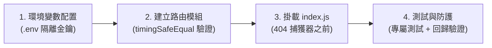

# 外部 Agent 專用輕量級 API 介面規範標準 (External Agent API Standard)

> **版本**：v1.0.0
> **制定日期**：2026-11-05
> **適用範圍**：所有需要供外部 AI Agent、自動化腳本或第三方程序安全存取本系統特定領域資料（如 Drafts、Knowledge、Review 等）的 HTTP API 接口。

---

## 1. 設計背景與核心安全原則

### 1.1 核心架構定位：按需旁路通道 (On-Demand Agent Bridge)
* **不是常規業務 API 的替代品**：各站點（微服務／專案）平常維持各自原本的架構運作（如 Web SPA 走 JWT、排程走既有工作流）。**絕對不是**把站點所有功能或通常使用都開成 `/api/agent/`。
* **按需開通原則 (On-Demand Only)**：只有在「**外部另一個獨立 Agent 確實有特定跨站點/跨專案存取需求**」時，才在該站點單獨多開闢這一條受限、安全、隔離的旁路通道。沒有對接需求就無需建立。
* **嚴禁暴露最高權限金鑰**：Supabase `Service Role Key` 會繞過所有 RLS（列級安全性）且具備整庫讀寫刪權限，**絕對禁止**交給外部 Agent 或放在未隔離的環境。
* **避免互動式登入負擔**：外部 Agent 不需要且不應走使用者層級的帳密、OAuth 或短效 JWT Session 換發流程。
* **隔離爆炸半徑**：各個 Agent 任務領域（例如：草稿改寫、內容審閱、知識檢索）應具備獨立的存取權限與專用金鑰，互不干擾。


### 1.2 四大安全鐵律 (Four Golden Rules)
1. **最小權限原則 (Principle of Least Privilege)**：
   * 接口預設一律為 **純唯讀 (`SELECT`)**。
   * 資料庫查詢必須精準宣告選取欄位（Explicit Projection），嚴禁 `SELECT *` 暴露敏感元資料或用戶資訊。
2. **金鑰實體隔離 (Domain-Scoped Keys)**：
   * 每個領域必須使用獨立命名的環境變數（例如 `AGENT_DRAFT_API_KEY`）。
   * **絕對禁止**複用擷取端（n8n）的 `MEDIA_API_KEY` 或系統服務端金鑰。
3. **時序攻擊防護 (Timing Attack Safe)**：
   * 比對金鑰時，一律採用 Node.js 原生的 `crypto.timingSafeEqual`，禁止使用一般字串相等運算子（`===`）。
4. **Agent-First 友善結構**：
   * 後端應負責跨表 JOIN 與資料清洗，將關聯資料整合成扁平、直觀的 JSON，讓消費端 Agent 拿來即可直接推理，無需自行解析資料庫結構。

---

## 2. 介面協議與請求標準 (Interface Contract)

### 2.1 路由命名規範
所有外部 Agent 專用端點一律掛載於 `/api/agent/` 命名空間下：
```text
/api/agent/<domain>/[action|resource]
```
* **草稿領域實例**：
  * `GET /api/agent/drafts`（列表與篩選）
  * `GET /api/agent/drafts/:id`（單筆詳情）

### 2.2 身份驗證標頭 (Authentication Headers)
為了最大化與各類 Agent 框架（LangChain, LlamaIndex, cURL, Python requests）相容，中介軟體必須**同時支援**以下兩種 Header 傳入方式：
1. `x-api-key: <AGENT_API_KEY>`
2. `Authorization: Bearer <AGENT_API_KEY>`

### 2.3 標準 HTTP 狀態碼
| 狀態碼 | 意義 | 觸發情境 |
| :--- | :--- | :--- |
| `200 OK` | 成功 | 資料查詢成功，回傳包含 `success: true` 的 JSON |
| `401 Unauthorized` | 認證失敗 | 缺少 Header、Key 不匹配或格式錯誤 |
| `404 Not Found` | 資源不存在 | 指定的資源 UUID 不存在 |
| `503 Service Unavailable`| 伺服器未設定金鑰 | 後端 `.env` 尚未配置該領域對應的 API Key |
| `500 Internal Error` | 內部錯誤 | 資料庫連線失敗或查詢異常 |

---

## 3. 現行實裝案例：Draft 稿件讀取 API

以本系統現已上線的 `content_assets` 與 `content_revisions` 為基準實裝規格：

### 3.1 端點列表
#### `GET /api/agent/drafts`
* **用途**：取得改寫草稿列表（自動合併最新版本內文）。
* **Query 參數**：
  * `status` (選填，預設 `draft`)：可傳 `draft`、`approved`、`published`，或傳 `all` 撈取全部。
  * `format` (選填)：篩選平台格式（如 `x_thread`, `linkedin_post`, `blog_article`）。
  * `limit` (選填，預設 `50`，最大 `100`)：控制筆數。

#### `GET /api/agent/drafts/:id`
* **用途**：取得單篇草稿完整資訊。
* **Path 參數**：`:id` (UUID)。

### 3.2 標準回應格式 (Payload Example)
```json
{
  "success": true,
  "count": 1,
  "drafts": [
    {
      "id": "9edd1029-e273-4954-9a25-0357472a4f7b",
      "title": "通勤一小時想練英聽？先從這 4 個資源開始",
      "format": "linkedin_post",
      "status": "draft",
      "content": "通勤一小時想練英聽，不一定要從「硬聽一整集 Podcast」開始。...",
      "latest_revision_number": 2,
      "change_summary": "Polished body",
      "metadata": {
        "route_type": "fast_rewrite",
        "source_url": "https://www.threads.net/@example/post/123"
      },
      "created_at": "2026-09-03T03:14:09.730Z",
      "updated_at": "2026-09-03T03:14:09.730Z",
      "revisions": [
        {
          "id": "rev-uuid-1",
          "revision_number": 1,
          "body": "原始第一版文字...",
          "author_type": "ai"
        },
        {
          "id": "rev-uuid-2",
          "revision_number": 2,
          "body": "通勤一小時想練英聽，不一定要從「硬聽一整集 Podcast」開始。...",
          "author_type": "user"
        }
      ]
    }
  ]
}
```

---

## 4. 新建 Agent 接口標準作業程序 (SOP Checklist)

若未來其他 Agent 需要存取其他領域資料（如 `topics`、`projects`、`review_packets`），必須嚴格依循以下四步驟建立：



### 步驟 1：定義專屬環境變數
在 `server/.env` 與 `server/.env.example` 中建立以 `AGENT_<DOMAIN>_API_KEY` 命名的金鑰：
```bash
# server/.env
AGENT_YOURDOMAIN_API_KEY=agt_yourdomain_xxxxxxxxxxxxxxxxxxxx
```

### 步驟 2：建立獨立路由模組樣板
建立 `server/routes/<domain>AgentRoutes.js`，套用以下官方樣板代碼：

```javascript
import express from 'express';
import { timingSafeEqual } from 'node:crypto';
import { supabase } from '../supabaseClient.js';

// 時序安全比對防護
function apiKeysMatch(providedKey, configuredKey) {
    if (typeof providedKey !== 'string' || typeof configuredKey !== 'string') return false;
    const provided = Buffer.from(providedKey);
    const configured = Buffer.from(configuredKey);
    return provided.length === configured.length && timingSafeEqual(provided, configured);
}

// 領域專屬認證中介層
export function requireDomainApiKey(req, res, next) {
    const configuredKey = process.env.AGENT_YOURDOMAIN_API_KEY;
    if (!configuredKey) {
        return res.status(503).json({ error: 'Domain Agent API is not configured' });
    }

    const authHeader = req.header('authorization');
    const bearerKey = authHeader?.startsWith('Bearer ') ? authHeader.slice(7).trim() : null;
    const providedKey = req.header('x-api-key') || bearerKey;

    if (!providedKey || !apiKeysMatch(providedKey, configuredKey)) {
        return res.status(401).json({ error: 'Unauthorized: Invalid or missing API key' });
    }

    next();
}

// 路由工廠函式（支援依賴注入以便測試）
export function createDomainAgentRouter({ db = supabase } = {}) {
    const router = express.Router();
    router.use(requireDomainApiKey);

    // GET /api/agent/<domain>
    router.get('/', async (req, res) => {
        try {
            const { data, error } = await db
                .from('target_table')
                .select('id, field_a, field_b, created_at')
                .limit(50);

            if (error) throw error;
            return res.json({ success: true, count: data.length, items: data });
        } catch (error) {
            console.error('[AgentAPI] Query error:', error);
            return res.status(500).json({ error: 'Internal query failure' });
        }
    });

    return router;
}

export default createDomainAgentRouter();
```

### 步驟 3：在 `server/index.js` 無侵入式掛載
* 引入該路由模組：
  ```javascript
  import domainAgentRouter from './routes/<domain>AgentRoutes.js';
  ```
* 掛載於既有路由區塊末端，**必須位於 `app.use('/api', (req, res) => ...)` 404 捕獲處理器之前**：
  ```javascript
  app.use('/api/agent/<domain>', domainAgentRouter);
  ```

### 步驟 4：自動化測試覆蓋
必須於 `test/server/<domain>_agent_routes.test.js` 撰寫自動化測試，至少涵蓋：
1. 未帶金鑰回傳 `401 Unauthorized`。
2. 錯誤金鑰回傳 `401 Unauthorized`。
3. `x-api-key` 與 `Authorization: Bearer` 均能通過認證。
4. 正常取得預期結構的資料。
5. 執行全量 `node --test test/server/*.test.js`，確認既有測試 100% 通過無回歸。
